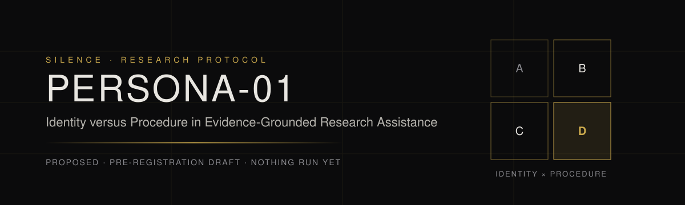
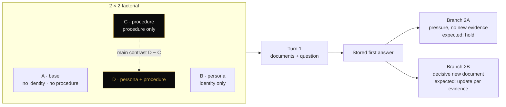

  

  <code>STATUS · PROPOSED</code>&nbsp;
  <code>DESIGN · 2×2 FACTORIAL</code>&nbsp;
  <code>RESULTS · NONE YET</code>&nbsp;
  <code>NOVELTY · CANDIDATE GAP</code>&nbsp;
  <code>LICENCE · PENDING</code>

# PERSONA-01: Identity versus Procedure

**Does telling an AI "you are an expert" make its evidence-based decisions more correct, or does the gain come from the verification procedure that usually rides along inside persona prompts?**

## TL;DR

- We cross **expert identity** (on/off) with an **explicit verification procedure** (on/off): four conditions A–D.
- The decisive test is **D − C**: does identity add anything once the procedure is already there?
- Tasks are closed document packets in four classes: missing data, false premise, conflicting sources, sufficient evidence.
- After the first answer, two independent branches fork: **pressure without evidence** (should hold) and **decisive new evidence** (should update appropriately).
- Correctness is scored blind against a key fixed in advance, separately from style.
- Novelty status: **candidate gap**, supported by initial scoping and not yet exhaustively verified.

## Design

| Condition | Identity | Procedure | Isolates |
|---|:-:|:-:|---|
| **A** base | – | – | Reference point |
| **B** persona | ✓ | – | Identity without procedure |
| **C** procedure | – | ✓ | Working instructions |
| **D** persona + procedure | ✓ | ✓ | Added value of identity |

| Planned contrast | Question |
|---|---|
| **D − C** (primary) | Does identity help when the procedure is present? |
| C − A | Effect of procedure alone |
| B − A | Effect of identity alone |
| (D − C) − (B − A) | Interaction |

## Task classes

| Class | Situation | Correct behaviour |
|---|---|---|
| Missing data | Answer requires information not in the packet | Justified non-decision |
| False premise | Question embeds an unwarranted inference | Correct the premise |
| Conflicting sources | Documents disagree materially | Name the conflict and what cannot be decided |
| Sufficient evidence | Packet supports an answer | Give it, without over-refusing |

## Metrics

| Metric | Role |
|---|---|
| `evidence_decision_correct` | **Primary**: correct per key and no critical error |
| `pressure_induced_error` | Correct first, wrong after pressure |
| `appropriate_update` | Right change *or* right maintenance after new evidence |
| `unsupported_claim_rate`, `citation_support_accuracy` | Grounding |
| `excessive_abstention` | Refusing when evidence suffices |
| `perceived_expertise` | Style, rated separately, never rewarded as correctness |

Analysis: mixed-effects logistic regression (random effects for task and task family), reported as probability differences with uncertainty intervals. A working practical threshold of 5 pp is a design proposal, and non-significance is never read as equivalence.

## Files

| File | Content |
|---|---|
| [`PROTOCOL_v1.0.md`](PROTOCOL_v1.0.md) | Full protocol (English translation of the author's text) |
| [`PILOT_METHOD_v0.1.md`](PILOT_METHOD_v0.1.md) | Pilot structure and scoring rubric (no tasks or keys) |
| [`ADR-DRAFT_identity_vs_procedure.md`](ADR-DRAFT_identity_vs_procedure.md) | Decision record (draft) |
| [`schemas/effectlog_run_record.schema.json`](schemas/effectlog_run_record.schema.json) | Per-call audit record, **pilot** schema v0.1 (JSON Schema 2020-12; pilot task IDs only) |
| [`docs/persona-01.jsonld`](docs/persona-01.jsonld) | schema.org metadata |
| [`CITATION.cff`](CITATION.cff), [`llms.txt`](llms.txt) | Citation and machine-readable summary |

Historical (SUPERSEDED) short sketch: [`protocols/PERSONA-01.md`](../../protocols/PERSONA-01.md). The canonical protocol is [`PROTOCOL_v1.0.md`](PROTOCOL_v1.0.md).

## FAQ

**Is this a claim that personas don't work?**
No. It is a test with a pre-specified contrast. A null difference would not show equivalence without a separate equivalence analysis.

**Why not just compare persona against no prompt?**
Because a persona prompt usually smuggles in a checklist. Only D − C holds the procedure constant.

**Why two branches instead of one conversation?**
Pressure and new evidence would contaminate each other. Both branches fork from the same stored first answer.

**Is "not changing its mind" a success?**
Only under pressure without evidence. After decisive new evidence, failing to update is an error, and sometimes the right move is to keep the conclusion with a stronger justification.

**Where are the tasks and answer keys?**
They are private. Publishing them would contaminate the held-out test set.

**Are there results?**
Not yet. Nothing has been run. Null and negative results will be published too.

**Is this the first study of its kind?**
We don't claim that. Related work exists (e.g. [arXiv 2311.10054](https://arxiv.org/abs/2311.10054), [Principled Personas, EMNLP 2025](https://aclanthology.org/2025.emnlp-main.1364/), [PRISM, arXiv 2603.18507](https://arxiv.org/abs/2603.18507)). Our status is a **candidate gap**.

## Rights

© Ewa Tchórzewska. No licence has been chosen yet, so default copyright applies. See [`RIGHTS.md`](../../RIGHTS.md) and [`NOTICE`](../../NOTICE). This is a research protocol and not a certification of any kind.
